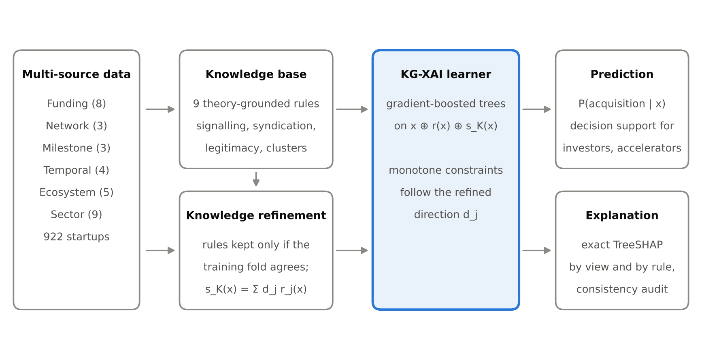

# KB-XAI: Explainable Knowledge-Based Startup Success Prediction

Code for the short communication **"An Explainable AI Knowledge-Based Model for Predicting Startup Success Using Multi-Source Entrepreneurial Data"** (submitted to *Knowledge-Based Systems*).

KB-XAI encodes entrepreneurial-finance theory as a small knowledge base of directional rules, injects those rules into a gradient-boosted tree model as monotone constraints, explains every prediction with exact TreeSHAP, and audits whether the explanations agree with theory.



## Reproduce everything

```bash
pip install -r requirements.txt
python kbxai.py            # downloads data to ./data, writes ./results (~1 min)
```

One script (`kbxai.py`) produces every number, table and figure in the paper. Results are deterministic (`SEED = 42`).

| Output | Paper |
|---|---|
| `results/table1_performance.csv` | Table 1: predictive performance and monotonicity-violation rate |
| `results/table2_knowledge_audit.csv` | Table 2: knowledge base, rule importance, audit and ablation |
| `results/fig1_framework.png` | Figure 1: KB-XAI framework |
| `results/fig2_explanations.png` | Figure 2: global SHAP explanation and rule-consistency |
| `results/metrics.json` | Sample sizes, paired bootstrap CIs, alignment scores |
| `results/case_explanation.txt` | Example rule-grounded local explanation |

## Data

Crunchbase open data export (4 Dec 2015) as CSV, mirrored at [notpeter/crunchbase-data](https://github.com/notpeter/crunchbase-data): `companies`, `rounds`, `investments`, `acquisitions`. The data is licensed CC BY-NC 4.0 by Crunchbase and is downloaded on first run, not redistributed here.

## Design

- **Sample.** Startups first funded 2000–2012 with a resolved outcome. Success = acquired or IPO; failure = closed (n = 9,045).
- **No look-ahead.** Features use only the first 24 months after first funding. Startups that exit inside that window are removed. Investor track records count only deals and exits before each deal date, ranked within the deal year to remove the drift caused by the export's left-censored history. Undisclosed round amounts are kept as missing.
- **Out-of-time test.** Train on 2000–2008 cohorts (n = 5,209), test on 2009–2012 cohorts (n = 3,836).
- **Knowledge base (R1–R7).** Investor track record, investor experience, syndication, staged financing, financial resources, VC certification, cluster location. Each rule fixes the sign of a feature's effect and becomes a LightGBM monotone constraint.
- **Knowledge audit.** *MVR*: share of test startups whose predicted success falls when a rule feature improves. *KAS*: direction-signed Spearman correlation between a feature and its SHAP values.

## Main results (2009–2012 test cohorts)

| Model | Test AUC [95% CI] | MVR (%) |
|---|---|---|
| Logistic regression | 0.797 [0.783, 0.810] | 39.19 |
| Random forest | 0.815 [0.802, 0.829] | 22.83 |
| LightGBM, single-source | 0.804 [0.790, 0.818] | 30.10 |
| LightGBM, multi-source | 0.812 [0.799, 0.825] | 25.43 |
| **KB-XAI (proposed)** | 0.801 [0.787, 0.814] | **0.00** |

KB-XAI removes all theory-violating behaviour and raises mean knowledge alignment from 0.41 to 0.83, at a cost of 0.011 AUC (paired 95% CI 0.007–0.016) relative to the unconstrained multi-source model.

## License

Code: MIT. Data: CC BY-NC 4.0 (Crunchbase).
